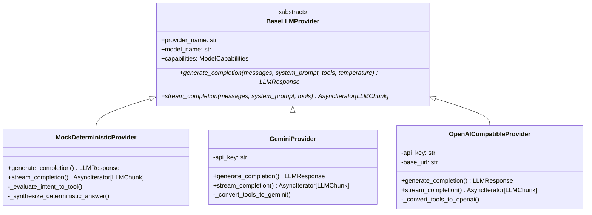

# ARTHSAVORA — LLM Provider Abstraction Layer

## 1. Overview

The **LLM Provider Abstraction Layer** decouples ARTHSAVORA's financial intelligence business logic from specific commercial AI model vendors. It guarantees provider interoperability, zero-vendor-lockin, offline test repeatability, and cost-controlled fallback capabilities.

---

## 2. Architecture & Class Hierarchy



---

## 3. Supported Providers

### 3.1. `MockDeterministicProvider` (Default / CI/CD)
- **Role**: Offline, zero-token-cost provider for automated testing, local development, and sandboxed validation.
- **Implementation**: Analyzes user prompts via regex intent recognition, selects exact matching financial tools, and formats verified mathematical responses with exact rupee figures and markdown tables.
- **Guarantees**: 100% deterministic, 0ms network latency, reproducible test assertions without external API dependencies.

### 3.2. `GeminiProvider`
- **Role**: Google Gemini 1.5 / 2.0 integration via Google GenAI SDK.
- **Capabilities**: Function calling with JSON schemas, streaming chunk generation, structured outputs.
- **Fail-safe**: If `GEMINI_API_KEY` is absent or network fails, automatically falls back to `MockDeterministicProvider` with an audit warning.

### 3.3. `OpenAICompatibleProvider`
- **Role**: Universal adapter for OpenAI models (GPT-4o, GPT-4o-mini) and self-hosted local engines (Ollama, vLLM, LocalAI) via HTTP standard `/chat/completions` REST API.
- **Configuration**: Uses `OPENAI_API_BASE` and `OPENAI_API_KEY`.

---

## 4. Factory Resolution (`get_llm_provider`)

The provider instance is resolved dynamically via `backend/app/services/assistant/providers/factory.py`:

```python
def get_llm_provider() -> BaseLLMProvider:
    provider_type = getattr(settings, "AI_ASSISTANT_PROVIDER", "mock").lower()
    if provider_type == "gemini":
        return GeminiProvider(...)
    elif provider_type in ("openai", "ollama", "vllm"):
        return OpenAICompatibleProvider(...)
    return MockDeterministicProvider()
```

---

## 5. Token & Latency Observability

Every provider call calculates:
- `tokens_prompt`: Number of tokens in input messages and system prompts.
- `tokens_completion`: Number of generated tokens.
- `latency_ms`: Round-trip execution time in milliseconds.

These metrics are recorded in `assistant_usage_logs` and surfaced to workspace owners for usage auditing.
