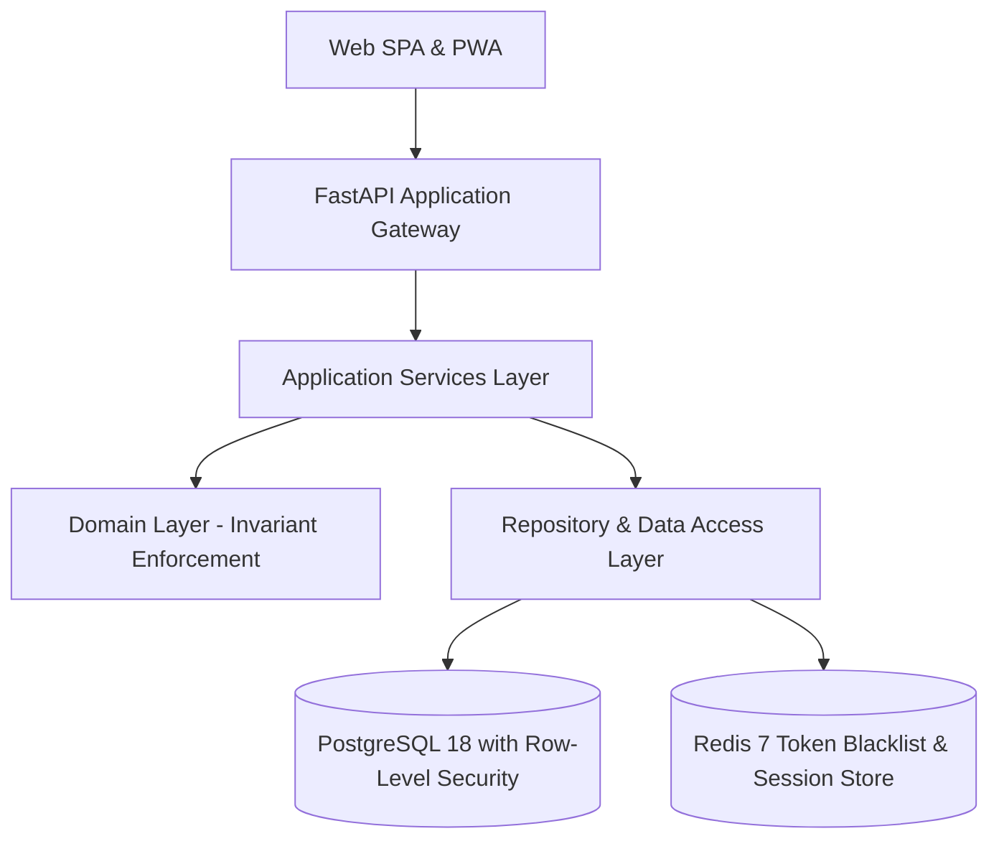

# Master Implementation Report

## 1. Overview of Platform Implementation

ARTHSAVORA represents an institutional-grade, multi-tenant commercial FinTech ecosystem. This report provides a comprehensive review of all implemented modules, backend services, domain models, database schemas, frontend interfaces, and operational integrations.

---

## 2. Implemented Subsystems & Modules

### 2.1 Backend Architecture (`backend/app/`)
- **Domain Layer (`app/domain/`)**:
  - `money.py`: `Money` value object backed by `Decimal` and 64-bit integer minor units (`paise`).
  - `workspace.py`: Personal, Family, and Business workspace isolation boundaries.
  - `ledger.py`: Immutable double-entry journal entries and lines with balance validation.
  - `account.py` & `transaction.py`: Core banking account types and lifecycle states.
  - `budget.py` & `goal.py`: Spending limits and milestone savings velocity calculators.
  - `recurring.py`: Leap-year pinned (Feb 29 $\rightarrow$ Feb 28) recurrence engine.
  - `business.py`: Commercial invoicing with 18% GST (CGST/SGST/IGST) calculations.
  - `family.py`: Multi-member household budgeting and automated peer settlement.
  - `financial_report.py`: Indian Financial Year (April 1 to March 31) bounds, Section 115BAC new tax regime slabs, and Section 87A rebate calculation.
  - `document.py`: Receipt intelligence entities with binary magic bytes validation.
- **Service Layer (`app/services/`)**:
  - `ledger_service.py` (33KB): Enforces atomic journal postings, balance updates, and trial balance generation.
  - `business_service.py` (55KB): Manages client directory, invoice generation, status transitions, and accounts receivable tracking.
  - `family_service.py` (41KB): Orchestrates household budgets, member roles, and peer settlements.
  - `financial_reporting_service.py` (39KB): Generates general ledgers, trial balances, GST summaries, and tax estimation reports.
  - `account_service.py` (35KB) & `transaction_service.py` (45KB): Core banking operations.
  - `import_service.py` (25KB): CSV and Excel bank statement parser with deduplication.
  - `workspace_service.py` (19KB): Tenant workspace provisioning, memberships, and role management.
- **API Router Layer (`app/api/v1/`)**:
  - 24 modular route controllers mounting clean RESTful endpoints with standard RFC 7807 error envelopes and OpenAPI documentation.
- **Infrastructure & Database (`app/infrastructure/database/`)**:
  - SQLAlchemy 2.0 async engine (`asyncpg`).
  - PostgreSQL Row-Level Security (RLS) dynamically synchronized on 46 tables.
  - `run_migrations.py`: Advisory lock runner (`pg_advisory_lock(987654321)`).

### 2.2 Frontend Architecture (`apps/web/`)
- **Application Shell (`src/components/layout/`)**:
  - `AppLayout.tsx`: Unified layout with skip-to-content accessibility link (WCAG 2.2 AA).
  - `Sidebar.tsx`: Grouped navigation covering Core Ledger, Planning, Intelligence, and Entity Workspaces.
  - `TopBar.tsx`: Global search, workspace switcher, and quick actions.
  - `MobileTabBar.tsx`: Mobile-first bottom navigation with ergonomic touch targets ($\ge 44 \times 44\text{px}$).
- **Page Dashboards (`src/pages/`)**:
  - 16 production views with full loading skeletons, empty states, error boundaries, and interactive modals:
    `Accounts`, `Transactions`, `Ledger`, `Budgets`, `Goals`, `Recurring`, `Forecast`, `Anomalies`, `Assistant`, `Documents`, `Notifications`, `Family`, `Business`, `FinancialConnections`, `FinancialReports`, `Settings`.
- **Progressive Web App (`src/pwa/`)**:
  - Valid W3C manifest, service worker lifecycle management, install prompt modal, and read-safe offline protections.

---

## 3. Integration Verification

- **Transactions $\rightarrow$ Ledger**: Confirmed transactions automatically generate balanced double-entry journal lines.
- **Business Invoicing $\rightarrow$ Ledger & GST**: Invoices calculate 18% GST (CGST/SGST/IGST), update Accounts Receivable, and feed GST summary reports.
- **Family Finance $\rightarrow$ Personal Privacy**: Family members can collaborate on shared household expenses while personal accounts remain strictly invisible (HTTP 404).
- **Documents $\rightarrow$ Security & Transactions**: Receipt upload validates `%PDF`/image magic bytes, rejecting disguised scripts before OCR parsing and transaction matching.
- **Frontend $\leftrightarrow$ Backend**: Shared TypeScript DTOs in `@arthsavora/contracts` and integer minor units (`paise`) guarantee zero contract drift.
