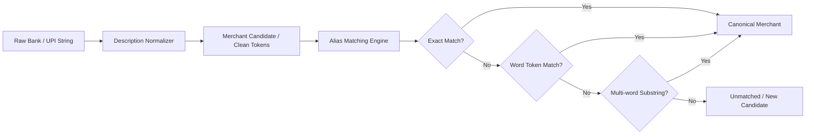

# Merchant Intelligence & Alias Recognition Architecture

## 1. Overview

Indian bank statements, card feeds, and UPI payment notifications rarely display clean merchant names. Instead, statements feature truncated corporate entities, aggregator prefixes, terminal identifiers, and city tags:
- `UPI/SWIGGY/123456789012/UPI-PAY` $\rightarrow$ Canonical Merchant: **Swiggy**
- `POS 4402 STARBUCKS COFFEE KORAMANGALA BLR` $\rightarrow$ Canonical Merchant: **Starbucks**
- `BUNDL TECHNOLOGIES PVT LTD` $\rightarrow$ Canonical Merchant: **Swiggy**
- `AMZN MKTP IN*404092 LUXURY GOODS` $\rightarrow$ Canonical Merchant: **Amazon**
- `ACH D-ZERODHA BROKING LTD SIP` $\rightarrow$ Canonical Merchant: **Zerodha**

The Arthsavora Merchant Intelligence module bridges this gap by decoupling raw statement text from clean canonical merchants through a relational alias network.



---

## 2. Entity Relational Design

The engine is modeled across two core tables: `merchants` and `merchant_aliases`.

```sql
CREATE TABLE merchants (
    id UUID PRIMARY KEY DEFAULT gen_random_uuid(),
    workspace_id UUID REFERENCES workspaces(id) ON DELETE CASCADE, -- NULL for system merchants
    canonical_name VARCHAR(150) NOT NULL,
    slug VARCHAR(150) NOT NULL,
    default_category_id UUID REFERENCES categories(id) ON DELETE SET NULL,
    merchant_type VARCHAR(50) DEFAULT 'general' NOT NULL,
    website VARCHAR(255),
    logo_url VARCHAR(500),
    is_verified BOOLEAN DEFAULT TRUE NOT NULL,
    status VARCHAR(20) DEFAULT 'active' NOT NULL,
    created_at TIMESTAMP WITH TIME ZONE DEFAULT CURRENT_TIMESTAMP NOT NULL,
    updated_at TIMESTAMP WITH TIME ZONE DEFAULT CURRENT_TIMESTAMP NOT NULL
);

CREATE TABLE merchant_aliases (
    id UUID PRIMARY KEY DEFAULT gen_random_uuid(),
    merchant_id UUID NOT NULL REFERENCES merchants(id) ON DELETE CASCADE,
    alias VARCHAR(200) NOT NULL,
    normalized_alias VARCHAR(200) NOT NULL,
    match_type VARCHAR(30) DEFAULT 'exact' NOT NULL, -- exact, prefix, word_boundary, fuzzy
    confidence NUMERIC(5, 4) DEFAULT 1.0000 NOT NULL,
    created_at TIMESTAMP WITH TIME ZONE DEFAULT CURRENT_TIMESTAMP NOT NULL,
    CONSTRAINT uq_merchant_normalized_alias UNIQUE (merchant_id, normalized_alias)
);

CREATE INDEX ix_merchant_aliases_normalized_alias ON merchant_aliases (normalized_alias);
CREATE INDEX ix_merchants_workspace_id ON merchants (workspace_id);
```

---

## 3. Tiered Alias Matching Algorithm

`MerchantRepository.find_alias_match` scans incoming transaction text using a three-tier deterministic resolution sequence:

### Tier 1: Exact Candidate & Description Match
Evaluates whether the extracted candidate (e.g. `SWIGGY`) or full normalized text equals a known `normalized_alias` in the database.
- Database index: B-Tree index on `normalized_alias`.
- Time complexity: $O(1)$ indexed lookup.

### Tier 2: Word-Boundary Token Matching
Evaluates whether individual whitespace-separated tokens in the description match registered word-boundary aliases:
```sql
SELECT alias.*, m.*
FROM merchant_aliases alias
JOIN merchants m ON m.id = alias.merchant_id
WHERE alias.normalized_alias IN ('POS', 'STARBUCKS', 'COFFEE')
ORDER BY alias.confidence DESC
LIMIT 1;
```

### Tier 3: Multi-Word Substring Matching
For corporate entities with multi-word representations (e.g., `"BUNDL TECHNOLOGIES"`, `"ONE97 COMMUNICATIONS"`, `"TATA 1MG"`):
```python
stmt = (
    select(MerchantAlias)
    .options(selectinload(MerchantAlias.merchant))
    .where(MerchantAlias.confidence >= Decimal("0.8000"))
)
aliases = list(res.scalars().all())
for al in aliases:
    if al.normalized_alias in full_normalized_text:
        return al.merchant, al
```

---

## 4. Curated Indian System Merchants

Arthsavora ships with pre-seeded canonical merchants and alias mappings covering high-frequency payment channels:

| Canonical Merchant | Merchant Type | Pre-configured Aliases | Default Category |
| :--- | :--- | :--- | :--- |
| **Swiggy** | Food Delivery | `SWIGGY`, `BUNDL TECHNOLOGIES`, `SWIGGY INSTAMART`, `SWIGGY XL` | `food-delivery` |
| **Zomato** | Food Delivery | `ZOMATO`, `ZOMATO LIMITED`, `BLINKIT`, `ZOMATO HYPERPURE` | `food-delivery` |
| **Uber** | Ride Hailing | `UBER`, `UBER INDIA`, `UBER BV`, `UBER TRIP` | `ride-hailing` |
| **Ola Cabs** | Ride Hailing | `OLA`, `ANI TECHNOLOGIES`, `OLA CABS`, `OLA MONEY` | `ride-hailing` |
| **Amazon** | E-Commerce | `AMAZON`, `AMZN MKTP`, `AMAZON PAY`, `AMAZON SELLER` | `general-shopping` |
| **Flipkart** | E-Commerce | `FLIPKART`, `FLIPKART PAYMENTS`, `FKMP`, `SUPERCOIN` | `general-shopping` |
| **Starbucks** | Cafe | `STARBUCKS`, `TATA STARBUCKS`, `STARBUCKS COFFEE` | `cafes` |
| **Zerodha** | Brokerage | `ZERODHA`, `ZERODHA BROKING`, `RAINMATTER` | `dividends` |
| **Groww** | Investments | `GROWW`, `NEXTBILLION TECHNOLOGY` | `dividends` |
| **Netflix** | Entertainment | `NETFLIX`, `NETFLIX ENTERTAINMENT`, `NETFLIX.COM` | `streaming-ott` |

---

## 5. Tenant Custom Merchants & Alias Expansion

Tenants can register custom merchants private to their workspace.
- Workspace custom merchants have `workspace_id = <uuid>`.
- System merchants have `workspace_id = NULL`.
- Universal system merchants are readable by all tenants; custom merchants are visible only to the owning workspace.
