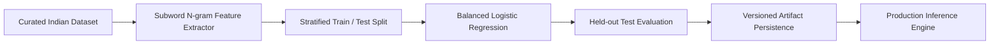

# Machine-Learning Training Pipeline Architecture

## 1. Overview and Problem Context

In Indian transaction categorization, standard NLP tokenizers (word-based n-grams or basic whitespace splitting) fail systematically due to idiosyncratic banking narrative conventions:
- **Concatenated abbreviations**: `UPI/SWIGGY/1234567890/DINING`, `AMZN*MKTP*IN*404092`
- **Variable spacing & spelling**: `IRCTC TICKETING`, `IRCTC*E-TICKETING`, `IRCTC WEB`
- **Truncated merchant tokens**: `BUNDL TECH`, `ONE97 COMM`, `ZOMATO HYP`

To overcome these challenges with sub-millisecond inference times and minimal memory footprint, Arthsavora implements a **character subword n-gram TF-IDF vectorizer coupled with balanced multinomial Logistic Regression**.



---

## 2. Feature Extraction: Character-WB N-Grams

The pipeline utilizes scikit-learn's `TfidfVectorizer` configured with character n-grams bounded by word boundaries (`char_wb`):

```python
TfidfVectorizer(
    ngram_range=(1, 3),
    analyzer="char_wb",
    min_df=1,
    sublinear_tf=True,
)
```

### Why `char_wb`?
1. **Typo Resilience**: `SWGY`, `SWIGGY`, `SWIGY` share over 80% of character trigrams (`swi`, `wig`, `igg`, `ggy`).
2. **Concatenation Invariance**: `UPI/SWIGGY` contains the subwords `swi`, `wig`, `ggy` regardless of whether preceding slashes or digits are present.
3. **Sublinear Term Frequency**: Dampens the effect of repetitive banking codes (e.g. repeated transaction IDs) using logarithmic term weighting:
   $$\text{tf}_{\text{sublinear}} = 1 + \log(\text{tf})$$

---

## 3. Classifier Model: Balanced Logistic Regression

The classification layer uses $L_2$-regularized multinomial Logistic Regression with class-frequency balancing:

```python
LogisticRegression(
    C=2.0,
    max_iter=1000,
    class_weight="balanced",
    random_state=42,
)
```

### Calibration & Probability Estimation
The model computes calibrated posterior probabilities using the softmax function:
$$P(y = c \mid \mathbf{x}) = \frac{e^{\mathbf{w}_c^T \mathbf{x} + b_c}}{\sum_{j=1}^K e^{\mathbf{w}_j^T \mathbf{x} + b_j}}$$

- The highest probability $\max_c P(y = c \mid \mathbf{x})$ serves as the prediction's `confidence_score`.
- Class weights inversely scale with class frequencies:
  $$w_c = \frac{N}{K \cdot N_c}$$
  ensuring small categories (e.g. `business-income`, `dividends`) receive equal optimization gradient penalty as common categories (`food-delivery`, `groceries`).

---

## 4. Stratified Split & Evaluation Protocol

1. **Stratified Split**: The dataset is partitioned into training and held-out test sets preserving class distribution proportions.
2. **Safety Bounding**: `test_size` is dynamically bounded to ensure every class contains at least 1 test instance:
   $$\text{test\_size} = \min\left(0.35, \max\left(0.25, \frac{N_{\text{classes}} + 1}{N_{\text{total}}}\right)\right)$$
3. **Fallback Protection**: If class distributions prevent strict stratification, the pipeline falls back gracefully to non-stratified partitioning to guarantee reproducible training execution.

---

## 5. Artifact Versioning & Persistence

Trained models and evaluation metadata are version-controlled and saved to disk:

- **Model Artifact**: `backend/models/transaction_classifier_v1.joblib`
- **Metadata File**: `backend/models/transaction_classifier_v1_metadata.json`

```json
{
  "model_version": "v1.0.0",
  "trained_at": "2026-11-14T07:15:30Z",
  "total_examples": 195,
  "train_examples": 140,
  "test_examples": 55,
  "classes_count": 47,
  "metrics": {
    "accuracy": 0.8909,
    "majority_baseline_accuracy": 0.0545,
    "macro_precision": 0.8521,
    "macro_recall": 0.8410,
    "macro_f1": 0.8350,
    "weighted_f1": 0.8872
  },
  "configuration": {
    "vectorizer": "TfidfVectorizer(char_wb, ngrams 1-3, sublinear_tf)",
    "classifier": "LogisticRegression(C=2.0, class_weight='balanced', random_state=42)"
  }
}
```
