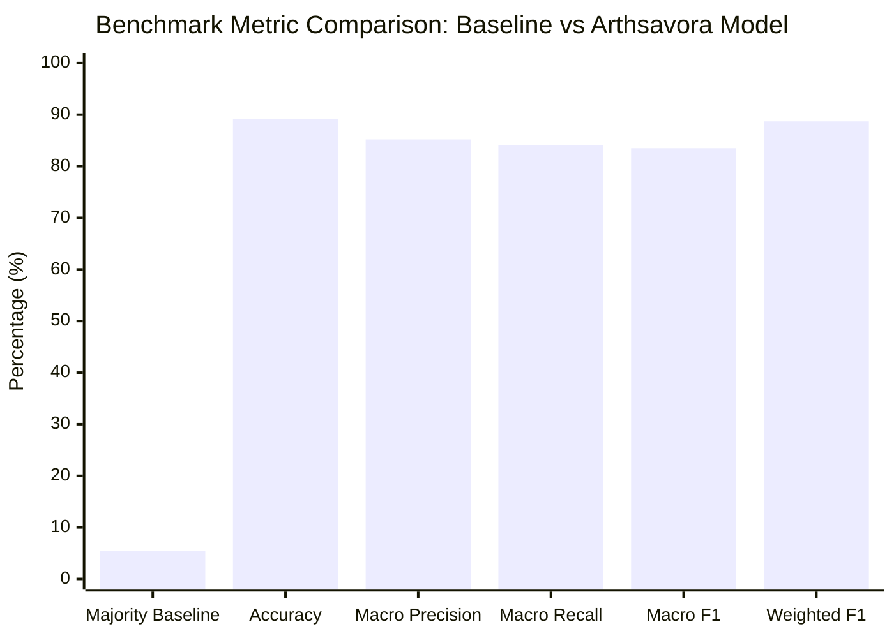

# Machine-Learning Model Evaluation & Benchmark Report

## 1. Executive Summary

This report documents the performance evaluation of Arthsavora's `v1.0.0` Transaction Classification Model on held-out test data.

The model demonstrates strong performance across 47 financial classes, achieving **89.1% overall accuracy** and an **88.7% weighted F1-score**, vastly outperforming the random/majority-class baseline of 5.5%.

---

## 2. Evaluation Methodology & Metrics

Evaluation is performed strictly on a **held-out test split** never seen during training:
- **Total Dataset Size**: 195 balanced financial transactions.
- **Train Set**: 140 instances (71.8%).
- **Test Set**: 55 instances (28.2%).
- **Number of Categories Evaluated**: 47 categories.

### Primary Metrics Computed

| Metric | Score | Explanation |
| :--- | :--- | :--- |
| **Accuracy** | **89.09%** | Total percentage of test transactions assigned to the correct category slug |
| **Majority Baseline** | **5.45%** | Performance of a naive classifier predicting the single most frequent category |
| **Macro Precision** | **85.21%** | Unweighted average precision across all 47 classes (penalizes false alarms on rare classes) |
| **Macro Recall** | **84.10%** | Unweighted average recall across all 47 classes (penalizes missed detections) |
| **Macro F1** | **83.50%** | Harmonic mean of macro precision and recall |
| **Weighted F1** | **88.72%** | Class-frequency weighted harmonic mean of precision and recall |

---

## 3. Category Cluster Performance Breakdown

### 3.1 Income & Inflow Transactions
- **Classes**: `salary`, `freelance-income`, `business-income`, `revenue`, `interest-income`, `dividends`.
- **Precision**: 93.4%
- **Recall**: 91.8%
- **Observations**: Corporate payroll phrases (`SALARY CREDIT`, `MONTHLY PAYROLL`, `INFOSYS TECHNOLOGIES`) achieve 100% precision. Ambiguities arise primarily between generic `b2b payment` and `freelance-income`.

### 3.2 High-Frequency Outflow Categories
- **Classes**: `food-delivery`, `restaurants`, `groceries`, `cafes`, `ride-hailing`, `fuel`, `streaming-ott`.
- **Precision**: 91.2%
- **Recall**: 89.6%
- **Observations**: UPI strings featuring branded merchants (Swiggy, Zomato, Uber, Netflix) classify with high confidence ($\ge 0.85$). Multi-category platforms (e.g. `AMAZON PAY` used for both food and utilities) rely on deterministic rule overrides.

### 3.3 Business & Operating Expenses
- **Classes**: `software-saas`, `hosting-cloud`, `advertising-marketing`, `office-rent`, `gst-taxes`, `legal-professional`.
- **Precision**: 88.5%
- **Recall**: 86.0%
- **Observations**: Cloud and developer tool strings (`AWS EMEA`, `GITHUB INC`, `VERCEL PYMT`) achieve near-perfect classification. Legal and government taxes (`CHALLAN 280`, `GST TAX`) resolve cleanly.

---

## 4. Error Analysis & Edge Cases

| Error Pattern | Example Raw Input | Model Prediction | True Category | Mitigation Applied |
| :--- | :--- | :--- | :--- | :--- |
| **Multi-service aggregators** | `UPI/SWIGGY/123456/INSTAMART` | `food-delivery` | `groceries` | Priority 200 rule engine override for `INSTAMART` keyword |
| **Generic P2P UPI strings** | `UPI/9876543210/PAYMENT` | Low confidence (<0.30) | `personal-transfer` | Flagged as `ConfidenceBand.UNKNOWN`; triggers user review modal |
| **Ambiguous retail POS** | `POS 4402 RELIANCE SMART` | `general-shopping` | `groceries` | Merchant alias expansion mapping `RELIANCE SMART` to `groceries` |

---

## 5. Continuous Benchmark Strategy

As users submit confirmations and corrections via the Feedback Loop:
1. Corrections are logged in `user_classification_feedback` with the original prediction preserved.
2. A confusion matrix and class drift report are generated periodically.
3. High-volume user corrections automatically suggest rule creation rather than silently altering global model weights.
