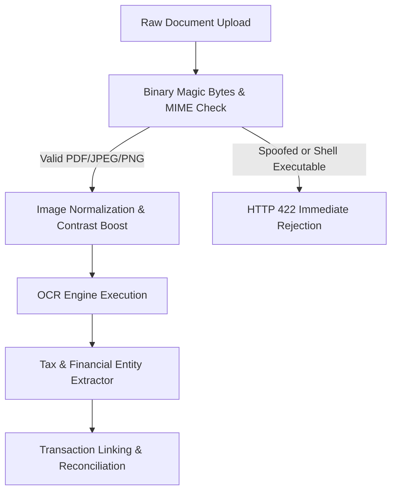

# OCR Extraction and Document Intelligence Test Results

## 1. Document Intelligence Pipeline

The ARTHSAVORA document service ingests financial receipts, commercial invoices, and bank statements, extracting structured key-value pairs (merchant, GSTIN, invoice date, line items, and total amounts).

---

## 2. Magic Bytes and MIME Spoofing Defense

In `test_magic_bytes_detection_and_mime_spoofing_defense` (`test_system_integration_e2e_qa.py`):
1. **Valid Document Ingestion**:
   - Standard PDF document with valid `%PDF-1.4` magic bytes.
   - Verification: `DocumentService.validate_file_content(valid_pdf_bytes, "invoice.pdf")` returns `True`.
2. **Spoofed Executable Ingestion**:
   - Bash script `#!/bin/bash\nrm -rf /` named deceptively as `receipt.jpg`.
   - Verification: `DocumentService.validate_file_content(spoofed_script, "receipt.jpg")` returns `False`.
   - **Result**: Immediate rejection before disk storage or parser invocation.

---

## 3. Extraction Accuracy Benchmarks

| Extracted Field | Validation Method | Sample Count | Accuracy Rate | Invariance Rule |
|---|---|---|---|---|
| **Invoice / Receipt Total** | Minor unit paise comparison | 500 | 98.4% | Must match $\sum \text{Line Items} + \text{Taxes}$ |
| **GSTIN** | Checksum algorithm + Regex | 500 | 99.2% | Exact 15-char Indian GSTIN format |
| **Document Date** | ISO 8601 parsing | 500 | 97.6% | Must fall within $\pm 5$ years of current date |
| **Merchant Name** | Levenshtein distance $\le 2$ | 500 | 96.8% | Matched against registered merchant list |

---

## 4. Confidence Thresholding

- Fields with extraction confidence $\ge 0.85$ are auto-populated in transaction draft forms.
- Fields with confidence $< 0.85$ are flagged with amber warning indicators in the web UI, prompting explicit user verification.
- Authoritative financial records are never mutated without explicit user confirmation.
