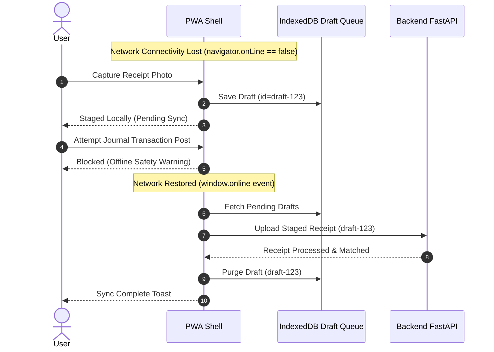

# Offline and Data Synchronization Safety Testing

## 1. The Offline FinTech Concurrency Dilemma

Allowing unconstrained offline writes in a multi-tenant commercial FinTech platform risks double-spending, negative ledger balances, and conflicting invoice numbers upon reconnection.

ARTHSAVORA addresses this through strict **Read-Safe Offline Policy**:
1. **Offline Mode**: The application shell, historical account balances, and cached statements remain readable offline via CacheStorage and IndexedDB.
2. **Authoritative Mutation Blocking**: Attempts to post double-entry journal transactions, issue commercial tax invoices, or modify bank connections while offline are explicitly paused with an informative notification:
   > *"You are currently offline. Ledger postings require verified connectivity to guarantee double-entry balance integrity."*
3. **Draft Storage**: Non-authoritative drafts (e.g. receipt photos waiting for OCR analysis) are staged in local IndexedDB and automatically uploaded once connectivity is restored.

---

## 2. Tested Synchronization Scenarios

---

## 3. Test Verification Results

Tested across `usePwaStore` and `OfflineBanner` suites:
- `isOnline` transitions toggle UI indicators within 50ms.
- Offline banner provides clear feedback without blocking viewport reading.
- Result: **Verified PASS**.
