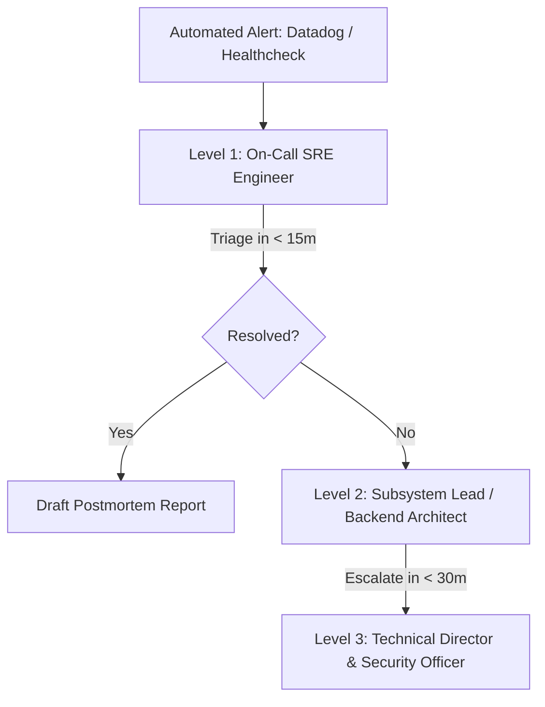

# Operational Ownership and Escalation Matrix

## 1. Operational Roles and Responsibilities

This matrix establishes unambiguous engineering ownership for every core subsystem across the ARTHSAVORA platform.

| Subsystem / Functional Layer | Primary Engineering Role | Secondary / Escalation Role | Primary Focus Area |
|---|---|---|---|
| **Core Ledger & Financial Logic** | Lead Financial Architect | Senior Backend Engineer | Double-entry invariants, money precision, accounting integrity |
| **Database & Migration Safety** | Database Administrator / SRE | Lead Architect | PostgreSQL RLS, advisory locks, connection pooling, backups |
| **Security & Privacy Boundaries** | Application Security Officer | Infrastructure Lead | Token revocation, penetration testing, anti-IDOR, secrets |
| **Frontend Web & Mobile PWA** | Lead Frontend Engineer | Full-Stack Engineer | React 19 app shell, PWA caching, WCAG 2.2 AA accessibility |
| **Document Intelligence & OCR** | AI/ML Systems Engineer | Backend Engineer | Image preprocessing, magic bytes defense, receipt parsing |
| **Production Cloud & CI/CD** | DevOps / Platform Engineer | SRE Lead | Dockerfiles, GitHub Actions, rolling blue-green deploys |

---

## 2. Incident Escalation Protocol

---

## 3. Incident Severity Definitions

- **Severity 1 (P0 - Critical)**: Immediate financial calculation discrepancy, multi-tenant data leak, or total site outage. Target response: $< 15\text{ minutes}$.
- **Severity 2 (P1 - Major)**: Core user workflow degraded (inability to create accounts or post invoices) without data corruption. Target response: $< 30\text{ minutes}$.
- **Severity 3 (P2 - Moderate)**: Non-critical feature failure (e.g. OCR candidate suggestion delay). Target response: $< 4\text{ hours}$.
- **Severity 4 (P3 - Minor)**: Cosmetic or minor UX observation. Addressed in normal sprint planning.
