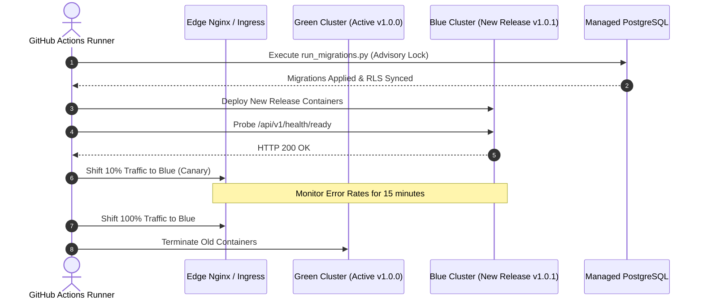

# Production Rollout and Traffic Shifting Plan

## 1. Rollout Strategy

ARTHSAVORA utilizes **Canary and Blue-Green Rolling Deployment** to eliminate user downtime and prevent operational regressions.

---

## 2. Canary Health Gates

Traffic shifting proceeds from 10% to 100% only if the following conditions remain true during the 15-minute observation window:
1. HTTP 5xx error rate remains $< 0.05\%$.
2. P95 API response latency remains $< 150\text{ms}$.
3. Zero database deadlocks or unhandled exceptions logged.
4. Process memory utilization remains $< 65\%$.

---

## 3. Communication Plan

- **Pre-Rollout (T-48h)**: In-app banner notifying users of upcoming minor release.
- **Rollout Window (T-0)**: Zero-downtime rolling update; existing user sessions preserved via Redis refresh tokens.
- **Post-Rollout (T+1h)**: Update changelog in app settings and notify beta cohort.
