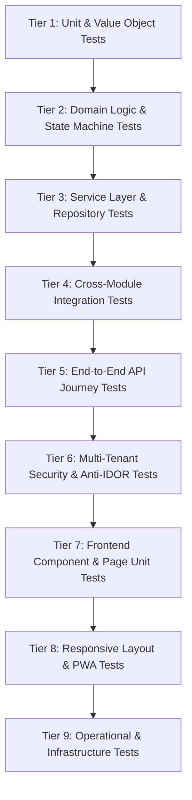

# Quality Assurance Execution Plan

## 1. Quality Assurance Mission and Core Principles

The ARTHSAVORA QA strategy guarantees that our institutional commercial FinTech platform operates with **zero tolerance for financial calculation error, zero tolerance for multi-tenant data leakage, and rigorous reliability across diverse client environments**.

### Key Principles
1. **Mathematical Invariance**: Financial figures must be exact. Minor units (paise) are mandatory. Floating-point arithmetic is forbidden in financial ledgers.
2. **Zero-Trust Multi-Tenancy**: Workspace isolation is enforced at the database row level (PostgreSQL RLS on 46 tables) and validated at every API boundary. Cross-tenant access must return HTTP 404.
3. **Double-Entry Equilibrium**: No journal entry may be posted where debits do not equal credits ($\sum D == \sum C$).
4. **Resilient Degradation**: Network interruptions, external provider outages, or document parsing failures must degrade safely without corrupting transactional state.

---

## 2. Nine-Tier Testing Architecture

### Detailed Tier Specifications

| Tier | Focus Area | Framework / Tools | Key Scope | Verification Target |
|---|---|---|---|---|
| **Tier 1** | Mathematical & Value Objects | Pytest, Vitest | `Money`, `Currency`, `Rounding`, exact paise calculations | 100% precision, no floating-point drift |
| **Tier 2** | Domain State Invariants | Pytest | `Transaction`, `Budget`, `Invoice`, `JournalEntry` lifecycles | Invalid state transitions blocked |
| **Tier 3** | Application Services | Pytest, SQLite/PostgreSQL | `AuthService`, `LedgerService`, `FamilyService`, `BusinessService` | Atomic transactions, rollbacks on error |
| **Tier 4** | Cross-Module Integration | Pytest, FastAPI TestClient | Transactions -> Ledger -> Analytics -> Budgets -> Anomalies | Domain event dispatching & consistency |
| **Tier 5** | End-to-End User Journeys | Pytest, FastAPI TestClient | Personal, Family, Business, and Tax full workflows | Real HTTP request/response validation |
| **Tier 6** | Security & Isolation | Pytest, Custom Scanners | Anti-IDOR 404 assertions, RLS policies, token revocation | 0 tenant leaks, 404 on foreign entities |
| **Tier 7** | Frontend UI & Store | Vitest, React Testing Library | 34 component/page suites, Zustand stores, navigation | 158 tests passing, accessible landmarks |
| **Tier 8** | PWA & Responsive UX | Vitest, JSDOM, CSS tests | Viewport scaling (360px-1440px), Service Worker caching | Offline safety, install modal flows |
| **Tier 9** | Production Operations | Docker, Shell, Pytest | Container healthchecks, migration advisory locks, Nginx headers | Zero-downtime deployability |

---

## 3. Test Execution Summary

- **Total Backend Tests**: 344 passed in 82.79s
- **Total Frontend Tests**: 158 passed in 38.69s
- **Total Monorepo Typecheck Packages**: 5 passed with 0 errors
- **Total Production Build Chunks**: 2,203 modules transformed cleanly
- **Automated Gate Result**: **100% PASS**
