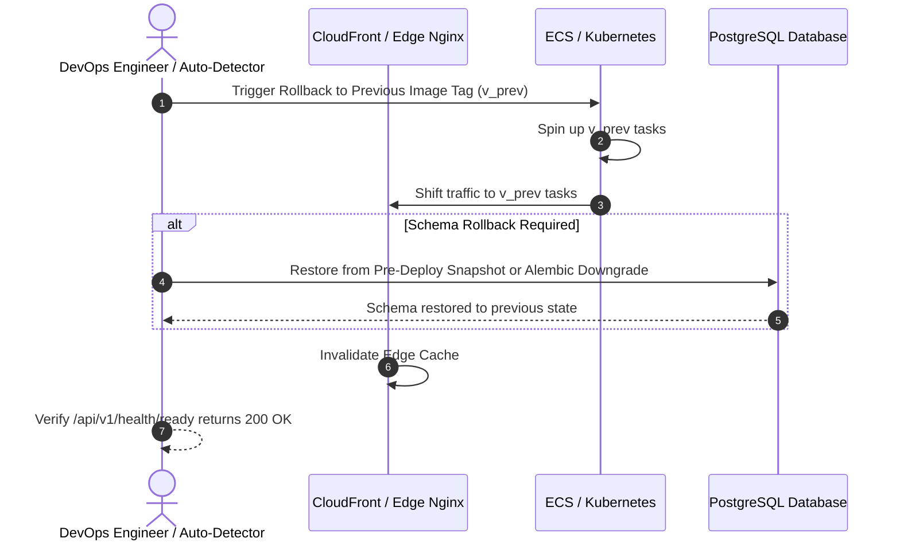

# Release Rollback Validation and Runbook

## 1. Rollback Strategy and Triggers

A production release rollback is triggered automatically or manually under any of the following critical conditions:
1. **Health Check Failure**: The `/api/v1/health/ready` probe returns HTTP 503 for more than 60 seconds following a deployment.
2. **Elevated Error Rate**: HTTP 5xx responses exceed 1.0% of total API traffic within 15 minutes of release.
3. **Financial Discrepancy**: Any detected unbalanced journal entry or balance reconciliation delta.
4. **Security Alert**: Cross-tenant data leakage or authentication bypass detected.

---

## 2. Rollback Execution Procedure



---

## 3. Rollback Runbook Steps

### Step 1: Divert Traffic (Immediate)
```bash
# Revert container image to previous known-good tag
docker compose -f docker-compose.prod.yml down
docker compose -f docker-compose.prod.yml up -d --build
```

### Step 2: Invalidate Edge Cache
```bash
# Purge stale static assets from reverse proxy / CDN
nginx -s reload
```

### Step 3: Database Downgrade (If Schema Was Altered)
```bash
# Apply targeted Alembic downgrade if migration was incompatible
uv run alembic downgrade -1
```

### Step 4: Verification
Confirm service restoration by querying the readiness endpoint:
```bash
curl -f http://localhost:8000/api/v1/health/ready
```
Target recovery time objective (RTO): $\le 15\text{ minutes}$.
