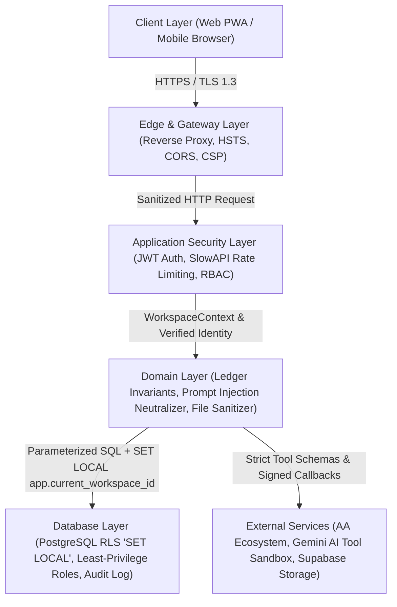

# ARTHSAVORA — Production Security Architecture

## 1. Executive Summary

ARTHSAVORA is an institutional commercial-grade FinTech management ecosystem designed for the Indian regulatory and banking landscape. Because the platform aggregates and processes high-value financial data—including bank account statements, double-entry general ledger journals, GST invoices, Account Aggregator consents, and AI-driven predictive cash-flow forecasts—its security architecture implements a rigorous **Defense-in-Depth** model.

Security controls are enforced by backend business services, database constraints, and network infrastructure, rather than relying on client-side frontend assumptions or developer conventions.

---

## 2. Core Security Principles

1. **Deny by Default:** Unauthenticated or unauthorized requests are rejected immediately at the boundary. Workspace tenancy resolution requires explicit active membership.
2. **Backend Authority:** Frontend UI state, local caching, and OCR extractions are treated as untrusted inputs. Financial mutations and authoritative records are minted exclusively by backend domain services.
3. **Defense-in-Depth:** Multiple redundant security controls protect critical data assets. For example, multi-tenancy is enforced at the API gateway layer (`X-Workspace-ID` resolution), domain service layer (workspace scoping), and database layer (PostgreSQL Row-Level Security).
4. **Zero Ambient Authority:** Permissions are not inherited automatically. Every sensitive API endpoint enforces granular permission requirements evaluated against the user's specific role in the active workspace.
5. **Exact Financial Integrity:** All monetary amounts are computed using exact fixed-point arithmetic (`NUMERIC(18, 4)` and integer sub-units). Double-entry general ledger equations ($\sum \text{Debits} = \sum \text{Credits}$) are strictly validated prior to commit. Posted journal entries are strictly immutable.
6. **Privacy by Design & Data Minimization:** Private financial records in family workspaces remain compartmentalized. Only explicitly shared expenses or pooled accounts are visible to other household members.

---

## 3. Defense-in-Depth Layered Architecture

### Layer 1: Client & PWA Boundary
- **Content Rendering:** React 19 JSX auto-escaping prevents Cross-Site Scripting (XSS). Direct `dangerouslySetInnerHTML` is forbidden.
- **Cache Isolation:** Service Worker strictly bypasses `/api/*` requests, ensuring zero sensitive financial data or auth tokens leak to browser disk caches.
- **Offline Integrity:** The offline fallback page displays clear disconnection banners and provides explicit warnings that financial records cannot be mutated offline.

### Layer 2: Network & Gateway Boundary
- **Transport Security:** Enforced TLS 1.3 with HTTP Strict Transport Security (`Strict-Transport-Security: max-age=31536000; includeSubDomains; preload`).
- **HTTP Security Headers:**
  - `X-Content-Type-Options: nosniff` (prevents MIME sniffing).
  - `X-Frame-Options: DENY` (prevents clickjacking and UI redressing).
  - `X-XSS-Protection: 0` (disables legacy insecure browser filters).
  - `Referrer-Policy: strict-origin-when-cross-origin`.
  - `Permissions-Policy: accelerometer=(), camera=(), geolocation=(), gyroscope=(), magnetometer=(), microphone=(), payment=(), usb=()`.
  - `X-Permitted-Cross-Domain-Policies: none`.
  - `Content-Security-Policy: default-src 'none'; frame-ancestors 'none'` on all `/api/*` endpoints.
- **Hardened CORS:** Explicit origin allowlisting (`settings.CORS_ORIGINS`). Wildcard origins (`*`) combined with credentials are strictly prohibited and throw an immediate startup error in production.

### Layer 3: Application & Identity Security
- **Authentication:** Dual-stack token validation supporting internal RS256/HS256 tokens and external Supabase Auth tokens. Tokens carry cryptographic UUID `jti`, `sub`, `iss`, `iat`, `exp`, and `nbf` claims.
- **Session Revocation:** Dedicated token revocation registry (`revoke_token_jti`) invalidates JWT sessions immediately on `/api/v1/auth/logout`.
- **Abuse Defense:** SlowAPI rate limiting throttles authentication endpoints (`5/minute` on `/login` and `/register`) to defend against credential stuffing and brute-force attacks.
- **Anti-Enumeration:** Standardized 401 `INVALID_CREDENTIALS` error code and timing-resistant validation on email/password combinations.

### Layer 4: Multi-Tenancy & Authorization
- **Workspace Boundary:** The tenant context is resolved from the `X-Workspace-ID` header or path parameter. If the user is not an active member, the system responds with `404 Not Found` (never `403`), preventing attacker tenant-probing.
- **Granular RBAC:** Over 45 distinct fine-grained permissions mapped across Personal, Family, and Business workspace topologies.
- **IDOR Elimination:** Every resource lookup joins against `workspace_id`. Cross-workspace query attempts return `404 Not Found`.

### Layer 5: Domain Engine & Financial Invariants
- **Double-Entry Ledger:** Balanced posting enforced at the database transaction level ($\sum \text{Debits} = \sum \text{Credits}$).
- **Immutable Journals:** Posted journals cannot be modified or deleted. Erroneous entries require explicit formal reversals with full audit attribution.
- **Document Safety:** Binary magic byte verification on all uploaded receipts/invoices prevents MIME spoofing. 15 MB file size limit protects against upload denial-of-service.
- **AI Safety:** Strictly allowlisted deterministic tool registry. Prompt injection attempts are neutralized to safe summary queries. Zero autonomous ledger mutations—all assistant actions require explicit human confirmation.

### Layer 6: Database Security & Storage Isolation
- **Row-Level Security (RLS):** All workspace-scoped tables enforce PostgreSQL Row-Level Security policies tied to `current_setting('app.current_workspace_id', true)`.
- **Transaction-Scoped Context:** `set_tenant_context` uses `SET LOCAL app.current_workspace_id`, ensuring connection pool recycling cannot leak tenant context across requests.
- **Audit Logging:** Append-only audit logs track financial mutations, membership modifications, and export operations. Audit attribution persists even if a member account is subsequently suspended.

---

## 4. Cryptographic Standards

| Purpose | Algorithm / Primitive | Key Length / Parameter | Rotation Strategy |
| :--- | :--- | :--- | :--- |
| **Password Hashing** | bcrypt | 12 Salt Rounds | Re-hashed on login when cost increases |
| **JWT Access Tokens** | HMAC-SHA256 (HS256) | 256-bit Secret Key | 24-hour expiration; instant revocation via JTI |
| **JWT Refresh Tokens** | HMAC-SHA256 (HS256) | 256-bit Secret Key | 30-day expiration; single-use rotation |
| **File Checksums** | SHA-256 | 256-bit hash | Computed on upload for deduplication & tamper check |
| **Data in Transit** | TLS 1.3 / 1.2 | AES-256-GCM / ChaCha20 | Managed by edge reverse proxy / load balancer |
| **Database Encryption** | AES-256 | PostgreSQL TDE / EBS Volume | Managed by cloud infrastructure / AWS KMS |

---

## 5. Security Boundary Verification Summary

The platform's security boundaries were verified via comprehensive unit, integration, and security regression suites:
- **Backend Tests:** 322 automated tests passed (100%).
- **Frontend Tests:** 158 automated tests passed (100%).
- **Monorepo Typecheck:** 0 type errors across all 5 workspace projects.
- **Repository Secrets:** 0 exposed secrets or private credentials across 698 tracked files.
