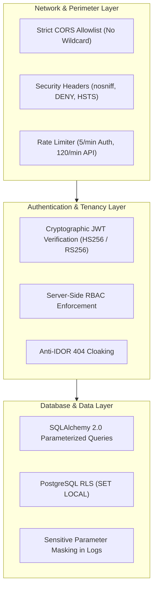

# Arthsavora — Security Implementation and Threat Mitigation

## 1. Security Architecture Overview

Arthsavora operates as a commercial fintech platform handling sensitive Indian banking, tax, and personal wealth records. Defense-in-depth is implemented across every layer of the backend application stack:

---

## 2. Environment Hardening & Secret Protection

### 2.1 Production Validation Rules (`backend/app/core/config.py`)
When `ENVIRONMENT=production`, the Pydantic Settings model executes deterministic security checks during container boot:
- **Secret Key Strength:** Enforces that `SECRET_KEY` is not the default development string and has a minimum length of 32 characters.
- **CORS Restrictions:** Forbids wildcard origins (`*`) when credentials are permitted.
- **Debug Disabled:** Ensures `DEBUG` mode is strictly `False`.
- **HSTS Activated:** Enforces `ENABLE_HSTS = True` (injects `Strict-Transport-Security: max-age=31536000; includeSubDomains; preload`).

### 2.2 Zero Credential Leaks
- No database credentials, API keys, or JWT secrets are hardcoded in the codebase.
- `.env` is ignored by Git; a safe `.env.example` provides documentation templates without real keys.
- Exception handlers suppress internal tracebacks, SQL strings, and connection parameters from all HTTP responses.

---

## 3. Hardened CORS and Security Headers

### 3.1 CORS Configuration (`backend/app/api/middleware/cors.py`)
Configured in strict compliance with W3C recommendations:
- `allow_origins`: Explicit list of approved origins (`http://localhost:5173`, `http://127.0.0.1:5173`, production domains).
- `allow_credentials`: `True` (enables cookies and Authorization headers).
- `allow_methods`: Explicit HTTP verbs (`GET`, `POST`, `PUT`, `PATCH`, `DELETE`, `OPTIONS`).
- `expose_headers`: `Content-Disposition`, `X-Request-ID`.
- `max_age`: 600 seconds (10 minutes preflight caching).

### 3.2 Security Response Headers (`backend/app/api/middleware/security_headers.py`)
Applied globally across all HTTP responses:
1. `X-Content-Type-Options: nosniff` — Prevents browsers from MIME-sniffing away from declared content types.
2. `X-Frame-Options: DENY` — Prohibits embedding within `<iframe>` or `<frame>` elements to completely block Clickjacking / UI Redressing.
3. `X-XSS-Protection: 0` — Modern standard disabling legacy, exploitable browser XSS auditors in favor of CSP.
4. `Referrer-Policy: strict-origin-when-cross-origin` — Protects internal route paths from leaking to third-party domains.
5. `Cache-Control: no-store, no-cache, must-revalidate, max-age=0` — Injected on all `/api/*` endpoints to prevent intermediate proxies or browser disk caches from storing sensitive financial balances.

---

## 4. Abuse Protection and Rate Limiting (`backend/app/core/limiter.py`)

Using SlowAPI with sliding window counters keyed by client IP or authenticated User ID:
- **Authentication Endpoints (`/api/v1/auth/login`):** Throttled to **5 requests / minute**. Defends against automated dictionary and credential stuffing attacks.
- **General Endpoints:** Default limit of **120 requests / minute**. Prevents scraping and denial of service.
- **Health Probes:** Limit of **300 requests / minute** to accommodate frequent Kubernetes orchestrator health checks.
- **Response Contract:** When rate limits are breached, the server returns HTTP 429 with standard `error` JSON envelope and `Retry-After: 60` header.

---

## 5. Request Idempotency Engine (`backend/app/core/idempotency.py`)

Financial mutations (ledger posting, account provisioning, batch imports) must never execute multiple times due to network retries.

### Idempotency Protocol
1. **Client Header:** Client supplies `Idempotency-Key: <unique-uuid>`.
2. **Fingerprint Computation:** Server computes `SHA-256(Method + Path + BodyBytes)`.
3. **In-Flight Lock:**
   - If a request with the same key is currently processing: Returns **409 Conflict** with `CONCURRENT_REQUEST`.
   - If previously completed with the same fingerprint: Server replays the cached status code and response body without re-executing business logic.
   - If key is reused with a different payload: Returns **422 Unprocessable** with `IDEMPOTENCY_FINGERPRINT_MISMATCH`.

---

## 6. Sensitive Data Redaction in Logging (`backend/app/api/middleware/audit.py`)

To ensure compliance with Indian financial privacy standards (Digital Personal Data Protection Act, 2023):
- `Authorization` headers, session cookies, and refresh tokens are excluded from all log sinks.
- Query parameters matching `password` or `token` are masked as `[QUERY_REDACTED]`.
- All access logs are structured with ISO timestamps, latency in milliseconds, sanitized HTTP methods, and correlation IDs (`X-Request-ID`).
