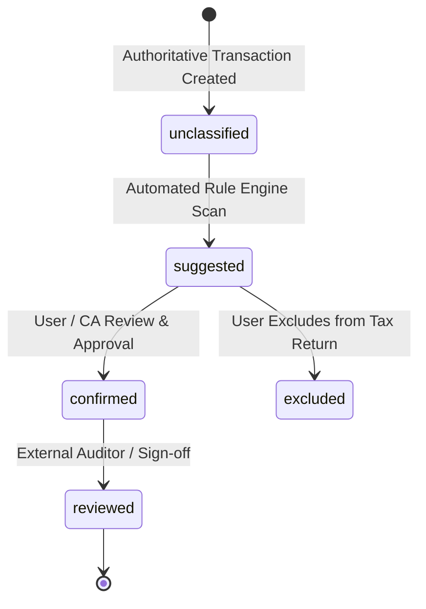

# ARTHSAVORA — TAX CLASSIFICATION ARCHITECTURE

## 1. Overview & Classification Lifecycle

The Tax Classification Engine tags financial transactions with statutory tax classifications using declarative, versioned rules, machine heuristics, and mandatory human confirmation.



---

## 2. Statutory Tax Categories & Sections

| Tax Category Code | Statutory Section | Default Deductible % | Typical Triggers & Merchants |
| :--- | :--- | :---: | :--- |
| `section_80c` | Section 80C (Income Tax Act) | 100% | PPF, EPF, ELSS Mutual Funds, Life Insurance (LIC), Principal Home Loan Repayment |
| `section_80d` | Section 80D (Income Tax Act) | 100% | Health Insurance Premiums (Mediclaim), Preventive Health Checkups |
| `business_expense_deductible` | Section 37(1) (Business Deductions) | 100% | AWS/GCP Cloud Hosting, GitHub, Adobe, Office Rent, Professional Consulting |
| `exempt_income` | Section 10 (Exempt Incomes) | 0% (Non-Taxable) | Agricultural Income, Dividend (historical), Maturity proceeds under 10(10D) |
| `gst_eligible_expense` | Section 16 (GST Input Tax Credit) | 100% | B2B Vendor Invoices with valid GSTIN and tax invoices |

---

## 3. Declarative Rule Seeding & Matching Logic

Default rules are seeded per workspace via `FinancialReportRepository.seed_default_tax_rules`:
```python
# Matching logic evaluation:
matches = False
if rule.match_merchant_name and rule.match_merchant_name.lower() in tx_description.lower():
    matches = True
elif rule.match_category and rule.match_category.lower() in tx_category.lower():
    matches = True
```

### Review & Override Capabilities
Users can adjust the deductible percentage (e.g. 50% for partial business/personal utility bills), modify the section, and attach audit notes explaining the business necessity.
