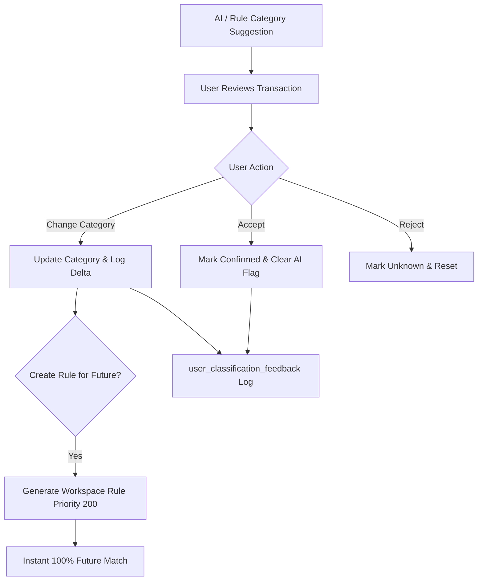

# User Feedback & Continuous Learning Architecture

## 1. Overview and Core Philosophy

In consumer and commercial fintech, probabilistic machine-learning models will inevitably make mistakes on ambiguous narrations, edge cases, or novel merchants.

Arthsavora solves this through an active human-in-the-loop **Feedback and Continuous Learning Engine**:
- Users maintain complete authority to confirm, correct, or reject any suggestion.
- User corrections generate **instant deterministic rules** so the system never repeats the same categorization mistake twice.
- All feedback actions are recorded in an immutable audit ledger (`user_classification_feedback`) with original predictions preserved for offline evaluation.



---

## 2. Feedback Actions and State Transitions

| Action | Description | `Transaction` Effect | `TransactionClassification` Effect | Rule Generated? |
| :--- | :--- | :--- | :--- | :--- |
| **`accept`** | User approves the suggested category | `is_ai_predicted = False` | `status = 'accepted'` | No |
| **`correct_category`** | User selects a different category | `category_id = new_id`, `is_ai_predicted = False` | `status = 'corrected'` | Optional (one-click checkbox) |
| **`correct_merchant`** | User corrects the merchant candidate | `merchant_name = clean_name` | `status = 'corrected'` | Optional alias creation |
| **`mark_unknown`** | User rejects suggestion without assigning | `category_id = NULL`, `is_ai_predicted = False` | `status = 'rejected'` | No |
| **`create_rule`** | User defines an explicit rule from transaction | `category_id = new_id`, `is_ai_predicted = False` | `status = 'accepted'` | Yes (`ClassificationRule` created) |

---

## 3. Immediate Deterministic Learning vs Global Retraining

Arthsavora explicitly distinguishes between **instant tenant adaptation** and **global model retraining**:

### 3.1 Instant Deterministic Adaptation (Zero Latency)
When a user corrects a transaction (e.g. changing `UPI/BLINKIT/12345/SNACKS` from `restaurants` to `groceries` with "Create Rule" checked):
1. The engine instantly generates a `ClassificationRule` in the tenant's workspace:
   ```json
   {
     "name": "Always categorize 'BLINKIT' as Groceries",
     "conditions": {
       "description_contains": ["BLINKIT"],
       "direction": "outflow"
     },
     "suggested_category_id": "<groceries_uuid>",
     "priority": 200,
     "rule_scope": "workspace"
   }
   ```
2. Subsequent transactions containing `"BLINKIT"` match this rule at Tier 1 with 100% confidence.
3. No ML model retraining, model recompilation, or deployment delay is required.

### 3.2 Offline Global Model Improvement
Feedback logs preserve:
- `original_category_id` vs `confirmed_category_id`.
- `original_method` (`ml_model`, `system_rule`, etc.).
- `model_version` (`v1.0.0`).
- Discrepancy metrics (precision, recall, false-positive distributions).

Engineers analyze aggregated confusion matrices during scheduled maintenance cycles to expand base training data without leaking private tenant data into global artifacts.

---

## 4. Feedback Audit Table Schema

```sql
CREATE TABLE user_classification_feedback (
    id UUID PRIMARY KEY DEFAULT gen_random_uuid(),
    workspace_id UUID NOT NULL REFERENCES workspaces(id) ON DELETE CASCADE,
    transaction_id UUID NOT NULL REFERENCES transactions(id) ON DELETE CASCADE,
    user_id UUID NOT NULL REFERENCES users(id) ON DELETE CASCADE,
    classification_id UUID REFERENCES transaction_classifications(id) ON DELETE SET NULL,
    original_category_id UUID REFERENCES categories(id) ON DELETE SET NULL,
    confirmed_category_id UUID NOT NULL REFERENCES categories(id) ON DELETE CASCADE,
    original_merchant_name VARCHAR(150),
    confirmed_merchant_name VARCHAR(150),
    original_method VARCHAR(50) NOT NULL,
    model_version VARCHAR(50),
    feedback_action VARCHAR(50) NOT NULL, -- accept, correct_category, correct_merchant, mark_unknown, create_rule
    feedback_reason VARCHAR(500),
    created_rule_id UUID REFERENCES classification_rules(id) ON DELETE SET NULL,
    created_at TIMESTAMP WITH TIME ZONE DEFAULT CURRENT_TIMESTAMP NOT NULL
);

CREATE INDEX ix_user_classification_feedback_workspace_id ON user_classification_feedback (workspace_id);
CREATE INDEX ix_user_classification_feedback_transaction_id ON user_classification_feedback (transaction_id);
```
