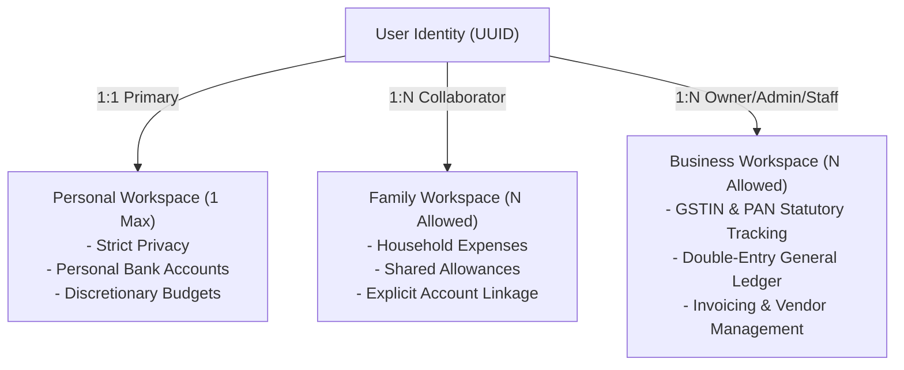
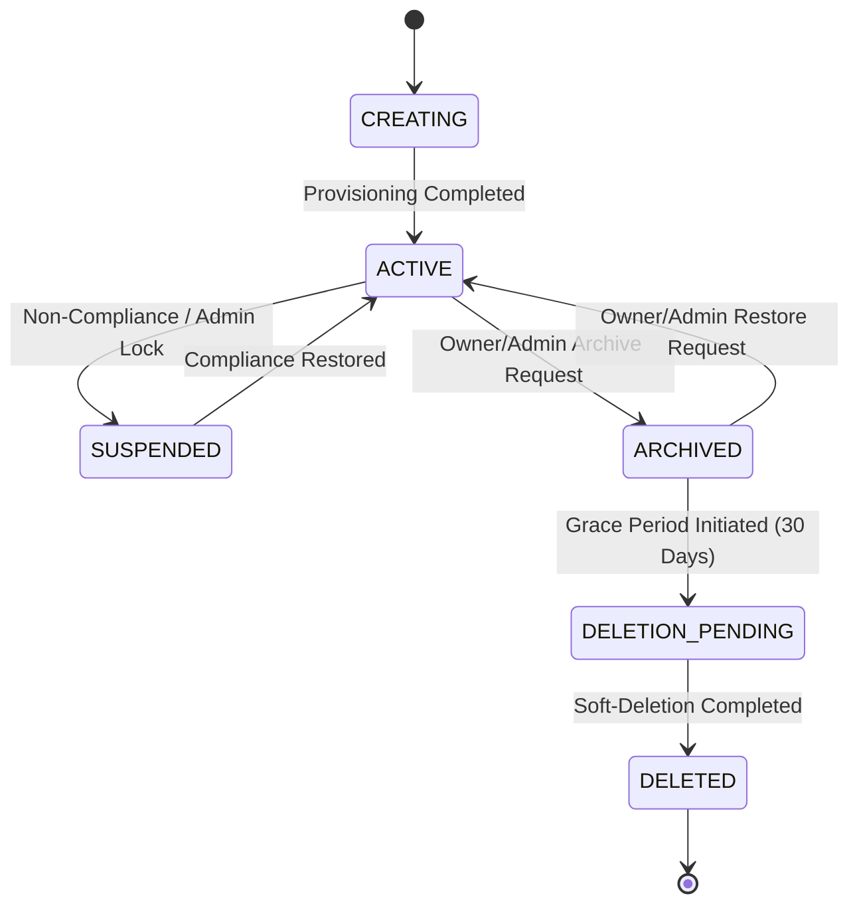
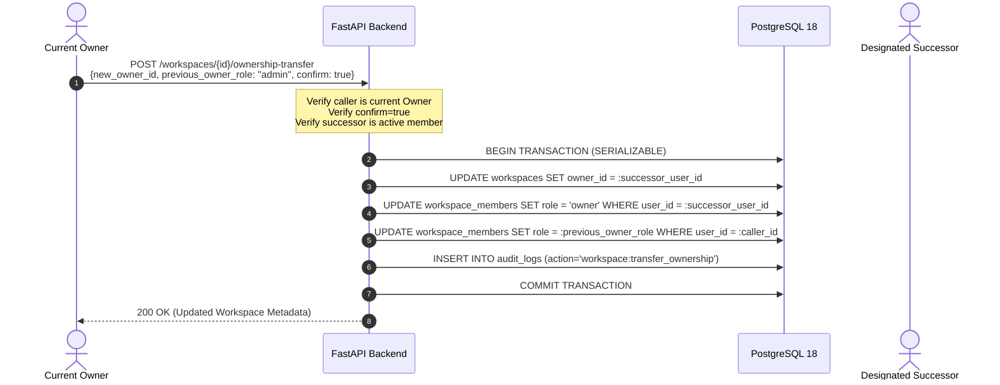

# ARTHSAVORA — WORKSPACE MANAGEMENT & MULTI-TENANCY ARCHITECTURE

## 1. Executive Summary

Arthsavora provides multi-tenant financial isolation using a flexible workspace architecture. Every financial entity (an individual, a household, a freelancer, or a small business) operates inside a dedicated `Workspace`. Users can hold distinct roles across multiple workspaces without data leakage.

---

## 2. Workspace Tenancy Models

Arthsavora natively supports three workspace types, each tailored to distinct operational and statutory requirements:

### 2.1 Personal Workspace
- **Tenancy Invariant:** Strictly **one** active personal workspace per user. Attempting to create an additional personal workspace raises `409 Conflict` (`DUPLICATE_PERSONAL_WORKSPACE`).
- **Provisioning:** Automatically created during user onboarding or initial registration.
- **Privacy Boundary:** Personal financial records (accounts, transactions, balances, credit lines) are completely private and cannot be inspected by family admins or business partners.

### 2.2 Family Workspace
- **Collaborative Household Scope:** Enables partners, dependents, and extended family to coordinate budgets and bills without compromising individual personal privacy.
- **Privacy Model:** Personal accounts do **not** automatically sync to family workspaces. Only accounts created explicitly inside the family workspace are visible to family members.
- **Roles Supported:** `owner`, `admin`, `member`, `viewer`.

### 2.3 Business Workspace
- **Commercial & Statutory Scope:** Supports freelancers, consultants, LLPs, partnerships, and private limited entities.
- **Statutory Profile Capture:**
  - `legal_business_name`: Registered legal entity name.
  - `trade_name`: Operating brand name.
  - `entity_type`: `freelancer`, `sole_proprietorship`, `partnership`, `llp`, `pvt_ltd`.
  - `gstin`: 15-character Goods and Services Tax Identification Number.
  - `pan`: 10-character Permanent Account Number.
  - `industry`: Business sector classification.
  - `financial_year_start_month`: Defaults to 4 (April 1st to March 31st for India).
- **Roles Supported:** `owner`, `admin`, `accountant`, `approver`, `staff`, `viewer`.

---

## 3. Workspace Lifecycle State Machine

Workspaces undergo strict state transitions governed by business rules and role authorization:

### 3.1 Lifecycle States

| State | Mutating Actions Allowed? | Read Access Allowed? | Description |
| :--- | :--- | :--- | :--- |
| `CREATING` | No | Internal only | Background provisioning and ledger seeding |
| `ACTIVE` | Yes (per role permissions) | Yes (per role) | Normal operational state |
| `SUSPENDED` | No | No | Access blocked due to statutory/safety violation |
| `ARCHIVED` | No (read-only) | Yes (authorized members) | Deactivated project; records preserved for audit |
| `DELETION_PENDING`| No | No | 30-day recovery holding state before deletion |
| `DELETED` | No | No | Soft-deleted; hidden from all standard queries |

### 3.2 State Transition Enforcement
- `POST /api/v1/workspaces/{id}/archive`: Transitions `ACTIVE` -> `ARCHIVED`. Rejects transitions from any status other than `ACTIVE` with `422 Unprocessable Entity` (`INVALID_STATE_TRANSITION`).
- `POST /api/v1/workspaces/{id}/restore`: Transitions `ARCHIVED` -> `ACTIVE`. Rejects transitions from any status other than `ARCHIVED` with `422 Unprocessable Entity` (`INVALID_STATE_TRANSITION`).
- All transitions generate immutable audit trail entries in `audit_logs`.

---

## 4. Controlled Ownership Transfer Protocol

To guarantee financial continuity, a workspace can never exist in an ownerless state. Ownership handover is executed as an atomic database transaction:

### Invariants:
1. **Single Owner Rule:** A workspace has exactly one user marked as `owner_id`.
2. **Successor Pre-requisite:** The target owner must already be an active member of the workspace.
3. **Explicit Confirmation:** Must supply `{"confirm": true}` in the request payload.
4. **Self-Transfer Prohibition:** Attempting to transfer ownership to oneself is rejected with `422 Validation Error`.
5. **No Owner Removal:** An owner cannot be revoked or deleted from `workspace_members` without first transferring ownership to another active member.
